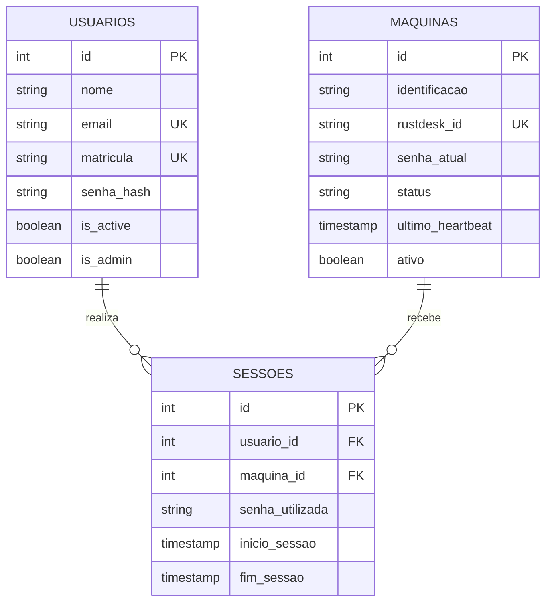

# Secure Remote Access Hub (Ecolab Hub)

Dashboard web e hub centralizado para o gerenciamento de acesso remoto seguro a computadores. Desenvolvido no laboratório Ecolab (FURG), o sistema permite monitorar o status de máquinas em rede e gerenciar credenciais de acesso temporárias do RustDesk.

## Funcionalidades

- **Monitoramento em tempo real:** visualização do status das máquinas conectadas (online/offline e último heartbeat).
- **Captura e rotação de credenciais:** recebimento automatizado das senhas dinâmicas do RustDesk através do agente cliente (`ecolab-client`).
- **Povoamento e reset rápido:** script de inicialização para zerar o banco de dados e semear o administrador e máquinas de teste com um único comando.
- **Ambiente 100% containerizado:** execução isolada de aplicação, banco de dados e túnel de rede via Docker.

## Tecnologias utilizadas

- **Back-end:** Python 3.11, Flask, SQLAlchemy, Gunicorn.
- **Banco de dados:** PostgreSQL 15.
- **Infraestrutura:** Docker & Docker Compose.
- **Acesso externo:** Ngrok (túnel reverso).
- **Software de acesso remoto:** RustDesk.

---

## Estrutura do Projeto

```text
/
├── routes/              # Módulos de rotas da aplicação (api.py, auth.py, views.py)
├── templates/           # Templates HTML do dashboard
├── static/              # Arquivos estáticos (CSS, JS, imagens)
├── app.py               # Ponto de entrada e fábrica do servidor Flask
├── models.py            # Definição dos modelos ORM (Usuario, Maquina, Sessao)
├── initDB.py            # Script automatizado de reset, criação de tabelas e seed
├── Dockerfile           # Imagem da aplicação web (Flask + Gunicorn)
├── docker-compose.yml   # Orquestração dos containers (web, db, ngrok)
├── .env                 # Variáveis de ambiente (não versionar)
├── requirements.txt     # Dependências Python do servidor
└── README.md
```

## Modelagem do Banco de Dados

O diagrama abaixo representa as entidades e os relacionamentos utilizados na aplicação.

### Diagrama entidade-relacionamento



## Como Executar em Ambiente de Desenvolvimento

### 1. Pré-requisitos

Certifique-se de ter instalado na sua máquina:

- [Git](https://git-scm.com/)
- [Docker Desktop](https://www.docker.com/products/docker-desktop/) (com o motor em execução).

### 2. Clonar o Repositório

```bash
git clone https://github.com/ThiagoNovinski/ecolab-remote-dashboard.git
cd ecolab-remote-dashboard
```

### 3. Configurar as Variáveis de Ambiente

Crie um arquivo `.env` na raiz do projeto com as seguintes configurações:

```ini
# Configurações do Flask
FLASK_APP=app.py
FLASK_ENV=development
SECRET_KEY=sua_chave_secreta

# Configurações do PostgreSQL
POSTGRES_USER=seu_usuario
POSTGRES_PASSWORD=sua_senha
POSTGRES_DB=nome_do_banco
DATABASE_URL=postgresql+psycopg2://seu_usuario:sua_senha@db:5432/nome_do_banco

# Acesso externo (Ngrok)
NGROK_AUTHTOKEN=seu_token_ngrok

# Dados do administrador padrão (Seed)
ADMIN_DEFAULT_EMAIL=seu_email
ADMIN_DEFAULT_PASSWORD=sua_senha
```

> **Importante:** os valores acima são exemplos para desenvolvimento. Utilize senhas fortes e não versione o arquivo `.env` no Git.

### 4. Subir a Infraestrutura com Docker

Execute o comando abaixo para construir as imagens e iniciar os serviços (`web`, `db` e `ngrok`):

```bash
docker compose up -d --build
```

O painel local estará disponível em:

```text
http://localhost:5000
```

### 5. Inicializar / Resetar o Banco de Dados (Seed)

Para criar as tabelas e povoar a base com o usuário administrador padrão e as máquinas de placeholder, execute:

```bash
docker compose exec web python initDB.py
```

> **Nota:** sempre que precisar resetar completamente os dados da aplicação durante o desenvolvimento, basta executar o comando acima novamente.

## Acesso Externo e Túnel Reverso

O projeto utiliza o container do **Ngrok**, integrado ao `docker-compose.yml`, para expor a porta `5000` à internet sem a necessidade de abrir portas no roteador ou firewall do laboratório.

Para descobrir a URL pública ativa gerada pelo túnel, acesse o painel interno do Ngrok:

```text
http://localhost:4040
```

> **Dívida técnica planejada:** o plano gratuito do Ngrok é utilizado para testes e prototipagem inicial.
>
> **Migração futura:** substituir o serviço `ngrok` pelo `cloudflared` (Cloudflare Tunnels), integrado a um domínio institucional da universidade. Isso permitirá utilizar uma URL permanente (ex.: `ecolab.furg.br`) e aproveitar os recursos de proteção e gerenciamento de tráfego oferecidos pela Cloudflare.

## Comandos Úteis do Docker

**Acompanhar os logs do servidor web:**

```bash
docker compose logs -f web
```

**Acessar o shell do Flask no container:**

```bash
docker compose exec web flask shell
```

**Encerrar os serviços:**

```bash
docker compose down
```

**Encerrar os serviços e apagar os volumes de dados:**

```bash
docker compose down -v
```

> **Atenção:** o último comando remove também os volumes persistentes, incluindo os dados armazenados no PostgreSQL.